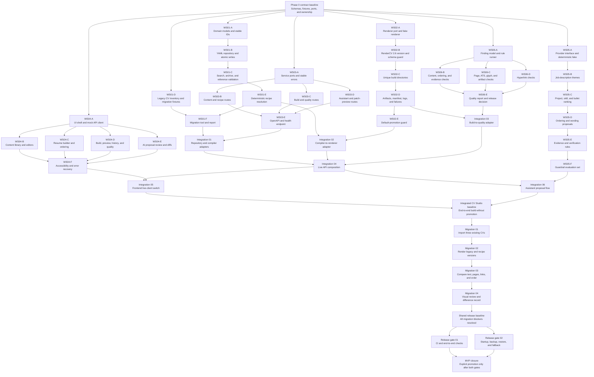

# CV Studio Parallel Execution Sequence

The CV Studio implementation is split into six workstream-owned lanes. The
only mandatory rendezvous points are the shared contract baseline, the main
integration sequence, and the migration and release gates. Tasks in different
lanes may run concurrently when their hard dependencies are satisfied.

## Start condition

Complete Phase 0 before implementation begins. It must freeze the common record,
recipe, build, finding, error, and AI-proposal shapes in
[contracts.md](contracts.md), provide representative fixtures, define service
ports, and confirm the ownership boundary for every workstream.

After this baseline is accepted, WS01 through WS06 start from the same contract
revision. No lane waits for another lane's implementation or imports its
unfinished code. Fixtures, fakes, and mock APIs provide all cross-lane behavior
during independent development.

## WS01 sequence: content library and migration

### Wave 1

WS01-A and WS01-D may start together:

- WS01-A defines domain models, record envelopes, evidence fields, and stable-ID
  rules.
- WS01-D inventories copies of the general, Axiom, and FootfallCam sources and
  creates migration fixtures without modifying those sources.

### Wave 2

WS01-B builds validated YAML persistence and atomic replacement over WS01-A.
WS01-C then adds search, archive and restore behavior, and record and bullet
reference validation.

### Wave 3

WS01-E resolves recipes into deterministic snapshots. WS01-F combines that
resolver with the migration inventory to produce proposed catalog files,
recipes, and a migration report.

## WS02 sequence: renderer and immutable builds

WS02 is deliberately sequential because each task strengthens the same build
boundary:

1. WS02-A publishes the renderer port and fake.
2. WS02-B enforces the exact RenderCV 2.6 pin and matching schema.
3. WS02-C allocates collision-safe build directories.
4. WS02-D records source, PDF, manifest, logs, and failed-build diagnostics.
5. WS02-E adds a separate promotion operation that rejects failed or incomplete
   builds.

Normal builds never overwrite cv/cv.yaml, cv/Samson_CV.pdf, or an earlier build.

## WS03 sequence: backend API

WS03-A freezes abstract service ports and stable error mapping. WS03-B, WS03-C,
and WS03-D may then run in parallel against fake services:

- WS03-B owns content and recipe endpoints.
- WS03-C owns build and quality endpoints.
- WS03-D owns assistant analysis and patch-preview endpoints.

WS03-E converges these route groups into a deterministic OpenAPI document and
health endpoint. Applying AI proposals returns a preview only; it does not save
the patch.

## WS04 sequence: frontend UI

WS04-A creates the application shell, navigation, typed mock client, and common
form behavior. Four screen groups can then be built in parallel:

- WS04-B: content library and editors.
- WS04-C: resume assembly, selection, and ordering.
- WS04-D: builds, PDF preview, history, and quality findings.
- WS04-E: AI analysis, evidence status, and approve or reject diffs.

WS04-F is the lane convergence task. It validates accessible ordering controls,
confirmation flows, draft preservation after validation errors, and consistent
loading, empty, and failure states.

## WS05 sequence: AI tailoring assistant

WS05 starts with a provider-neutral interface and deterministic fake. It then
builds a traceable pipeline from job-description themes, through relevance
ranking, to ordering and wording proposals. Every proposal includes source
record and evidence IDs before guardrail evaluation begins.

WS05-F covers unsupported technologies, missing evidence, team and tutorial
ownership, page-limit conflicts, and instruction-like text inside job
descriptions. The assistant never receives repository write access.

## WS06 sequence: quality and claims validation

WS06-A defines the finding contract and deterministic rule runner. WS06-B,
WS06-C, and WS06-D may then run in parallel:

- WS06-B checks content references, ordering, duplication, and claim evidence.
- WS06-C checks page limits, ATS text, glyphs, filenames, and artifacts.
- WS06-D checks public links through an injected HTTP client with explicit
  timeout and network-failure results.

WS06-E combines these findings into a machine-readable quality report and
release decision without modifying the source or PDF.

## Integration rendezvous

Integration remains with the main project owner and runs in dependency order:

1. Integration 01 connects the real content repository and compiler to API
   ports.
2. Integration 02 passes deterministic compiler output to the renderer.
3. Integration 03 sends completed builds to the quality service.
4. Integration 04 composes the live API after the first three adapters pass.
5. Integration 05 switches the frontend from mocks to the live API.
6. Integration 06 connects the assistant provider and proposal review flow.
7. Integration 07 exercises the full application without changing the default
   CV.

Adapter changes are preferred over rewriting completed workstream internals.

## Migration and release sequence

Migration starts only from the integrated baseline. Import the three existing
CV variants, render legacy and recipe-generated outputs, compare their extracted
text and metadata, and then perform a separate visual review. Record every
intentional difference; unresolved differences remain release blockers.

Once the shared release baseline is clean, Release Gate 01 and Release Gate 02
may run in parallel. MVP closure requires both gates. Default-CV promotion is an
explicit user action after closure, not an automatic release side effect.

## Hard dependency table

| Task | Must finish first |
|---|---|
| Phase 0 contract baseline | Approved contracts, fixtures, ports, and ownership |
| WS01-A | Phase 0 |
| WS01-B | WS01-A |
| WS01-C | WS01-B |
| WS01-D | Phase 0 |
| WS01-E | WS01-C |
| WS01-F | WS01-D and WS01-E |
| WS02-A | Phase 0 |
| WS02-B | WS02-A |
| WS02-C | WS02-B |
| WS02-D | WS02-C |
| WS02-E | WS02-D |
| WS03-A | Phase 0 |
| WS03-B | WS03-A |
| WS03-C | WS03-A |
| WS03-D | WS03-A |
| WS03-E | WS03-B, WS03-C, and WS03-D |
| WS04-A | Phase 0 |
| WS04-B | WS04-A |
| WS04-C | WS04-A |
| WS04-D | WS04-A |
| WS04-E | WS04-A |
| WS04-F | WS04-B, WS04-C, WS04-D, and WS04-E |
| WS05-A | Phase 0 |
| WS05-B | WS05-A |
| WS05-C | WS05-B |
| WS05-D | WS05-C |
| WS05-E | WS05-D |
| WS05-F | WS05-E |
| WS06-A | Phase 0 |
| WS06-B | WS06-A |
| WS06-C | WS06-A |
| WS06-D | WS06-A |
| WS06-E | WS06-B, WS06-C, and WS06-D |
| Integration 01 | WS01-F and WS03-E |
| Integration 02 | WS01-E and WS02-E |
| Integration 03 | WS02-D and WS06-E |
| Integration 04 | Integration 01, Integration 02, and Integration 03 |
| Integration 05 | Integration 04 and WS04-F |
| Integration 06 | Integration 04 and WS05-F |
| Integration 07 | Integration 05 and Integration 06 |
| Migration 01 | Integration 07 |
| Migration 02 | Migration 01 |
| Migration 03 | Migration 02 |
| Migration 04 | Migration 03 |
| Shared release baseline | Migration 04 with all blockers resolved |
| Release Gate 01 | Shared release baseline |
| Release Gate 02 | Shared release baseline |
| MVP closure | Release Gate 01 and Release Gate 02 |

The detailed acceptance criteria remain authoritative in the
[workstream plans](workstreams/01-content-library.md), while adapter and
migration behavior remains authoritative in the
[integration plan](integration-plan.md).
